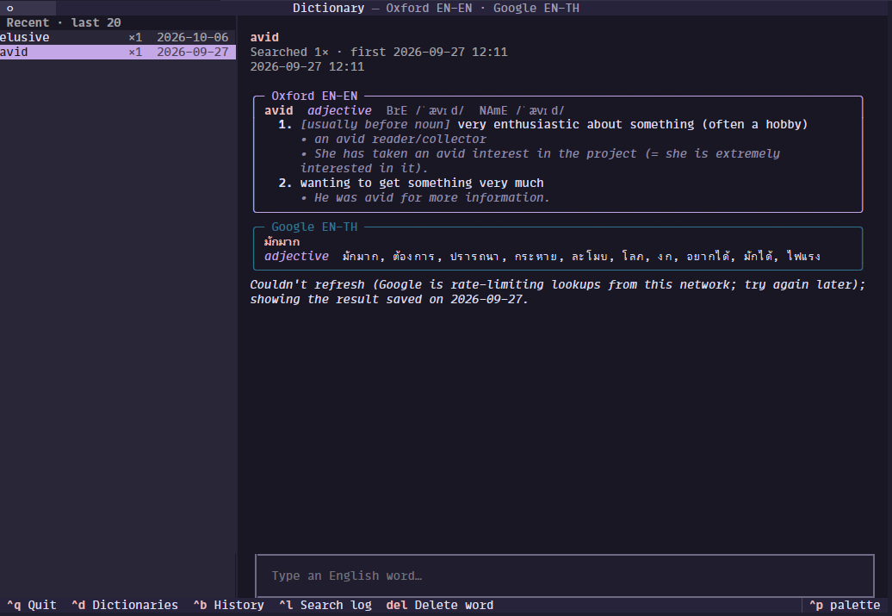

## What it is

A dictionary that lives in the terminal. Type an English word and its entries
from several dictionaries appear stacked on the right, so you can compare
definitions without opening four browser tabs. Your recent words sit in a
column on the left.

| Dictionary            | Source                                                |
| --------------------- | ----------------------------------------------------- |
| Oxford EN-EN          | oxfordlearnersdictionaries.com                        |
| Cambridge EN-EN       | dictionary.cambridge.org                              |
| Merriam-Webster EN-EN | the official API (free key)                           |
| Google EN-TH          | Google Translate                                      |
| macOS Dictionary      | the Dictionary app on a Mac, EN-EN and EN-TH, offline |

You choose which dictionaries to show, and in what order, with `Ctrl+D`.

## Remembering what I look up

Every search is saved to a local SQLite database: how often each word was
searched, when, and the full search log by day (`Ctrl+L`). Times read like
"10 min ago" or "yesterday" until a search is a week old.

The results are saved too. A word searched again shows instantly from the
database; a saved result older than 30 days is shown at once and refreshed in
the background. Failed lookups are not saved, so searching again retries them.

## How it is built

- **Python 3.14 + [Textual](https://textual.textualize.io/)** for the interface,
  with Rich panels for the results and a command palette (`Ctrl+P`) to change
  the theme or history size.
- **One module per dictionary.** Web sources are fetched with `httpx` and
  parsed with Beautiful Soup into shared dataclasses, so every dictionary
  renders the same way.
- **The macOS Dictionary without extra packages.** The app calls Apple's
  undocumented DictionaryServices (the ones Dictionary.app uses) through
  `ctypes`. If a macOS update breaks it, only that panel shows an error.
- **Settings in `config.toml`.** Changes made in the app are written back to
  the file, keeping its comments.
- **Tested offline.** Parser tests run against saved pages, and app tests drive
  the TUI headlessly with the network stubbed out.
