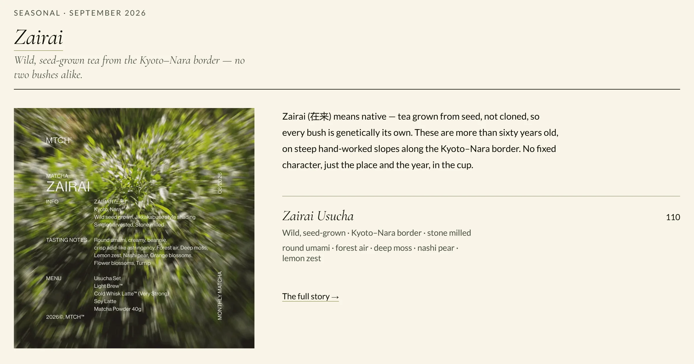
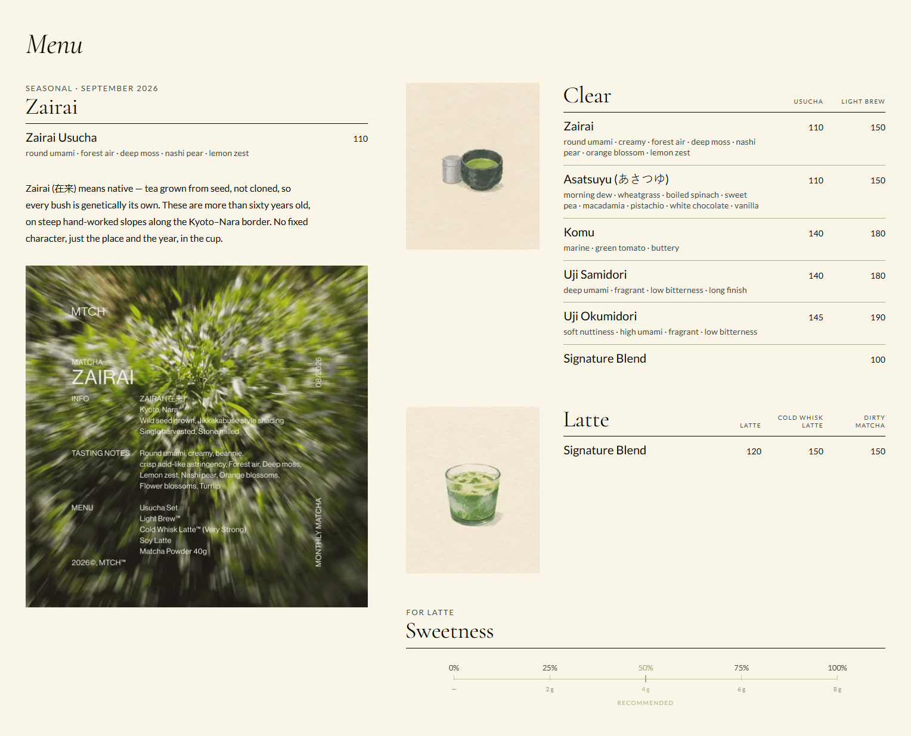

## What it is

A what-if: if I opened a matcha cafe, this is the menu I would hand you. There
is no cafe. It is a concept site for a place that only exists in my head,
written as if it opened tomorrow.

Each matcha gets its own page with its story, where it comes from and how it
tastes. The menu lists what each one is served as (clear, latte or powder to
take home), with prices in baht.



## The menu as content

Every matcha is one Markdown file. The frontmatter is the spec sheet:
cultivar, origin, shading days, harvest, processing, taste notes, and the drinks
it is sold as with their prices. The body is the story.

```yaml
name: 'Zairai'
notes: ['round umami', 'creamy', 'forest air', 'nashi pear']
info:
  cultivar: 'Zairai (在来) · Wild, seed grown'
  origin: 'Kyoto–Nara border · ~150 m'
  shading: '18–21 days'
menus:
  clear:
    - { title: 'Usucha', price: 110 }
    - { title: 'Light Brew', price: 150 }
```

Changing the menu is editing content, not code:

- **`available` toggles** take a whole matcha, or a single drink, off the menu
  without deleting anything. Past teas move to an `archived/` folder.
- **Seasonal menus** (a Sakura spring, a Christmas menu, and Zairai, the one
  on now) each live in their own folder and are switched on or off.
- **One sweetness scale** (0–100%, 2 g of syrup a step, 50% recommended) is
  defined once and shown wherever it's needed.

## The menu board

Besides the landing page, there is a compact **menu board**, the whole menu on
one screen, as it would hang above the counter, and a **print version**
laid out on A4 sheets.



## How it is built

- **Astro 7 + Tailwind CSS 4**, deployed to Cloudflare Workers.
- **Content collections** for matcha, seasonal menus, desserts, teaware and the
  site announcement, with Zod schemas that document every field.
- **Static pages** for each matcha, season and teaware item, generated from the
  content at build time.
