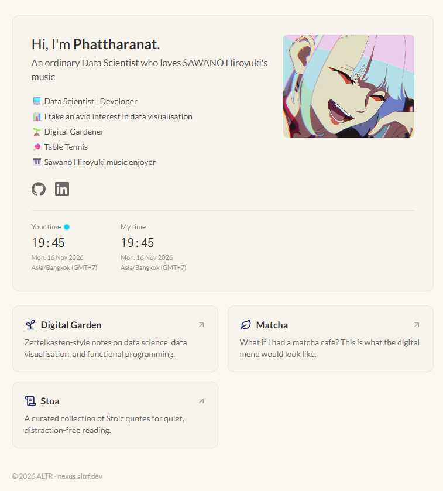

## What it is

Nexus is my link-in-bio page, in the spirit of Carrd or Linktree, but self-built.
One page: a profile card at the top, then a card for each thing I make: this
digital garden, [Matcha](https://matcha.altrf.dev/) and [Stoa](https://stoa.altrf.dev/).

The profile card has two live clocks, your time and mine (Asia/Bangkok), so
anyone who wants to reach me can see at a glance what time it is here.

## How it is built

- **Astro 7, fully static.** No backend, database or login. The build is plain
  HTML, deployed to Cloudflare at `nexus.altrf.dev`.
- **One MDX file per link.** Each link is a content-collection entry: the
  frontmatter holds the label, URL, Lucide icon and order; the MDX body becomes
  the short description under it. Adding a link means adding a file, not
  editing a component.
- **Tailwind CSS 4 with oklch design tokens.** One light theme (indigo primary,
  orange accent), defined as CSS variables so the whole page can be re-themed
  from one file.
- **Same conventions as this garden.** Nexus follows this site's patterns
  (the `@/` import alias, the Astro Font API, `@theme inline` tokens), so moving
  between the two projects costs nothing.
