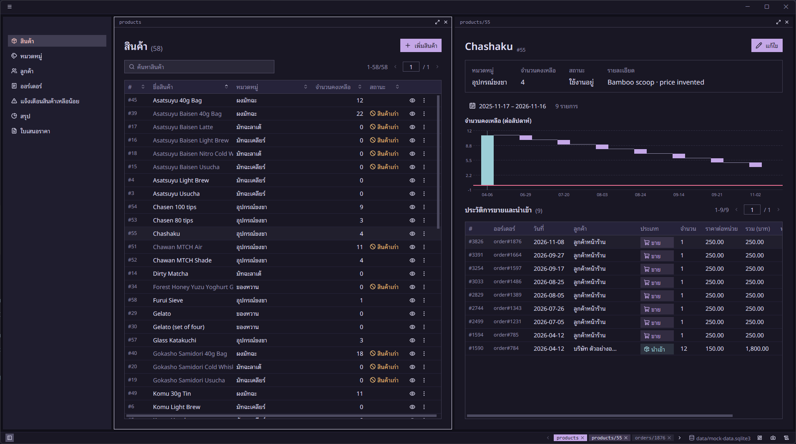
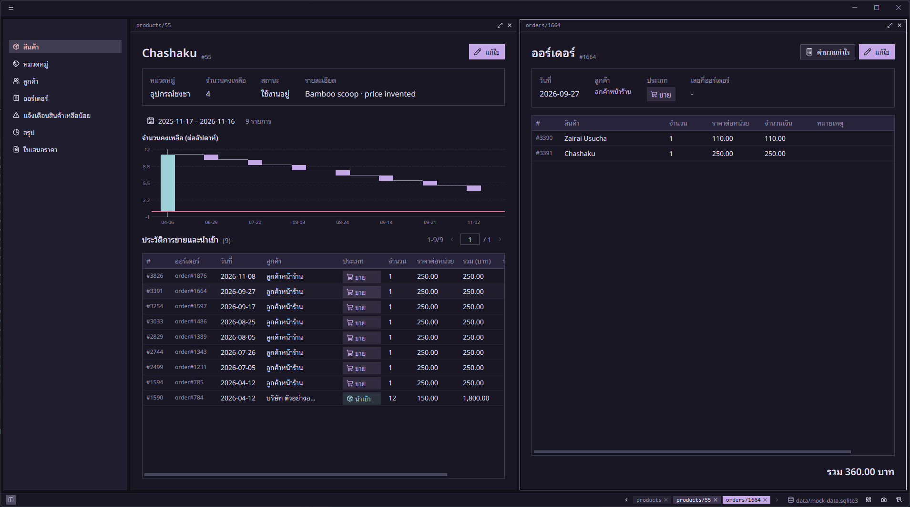
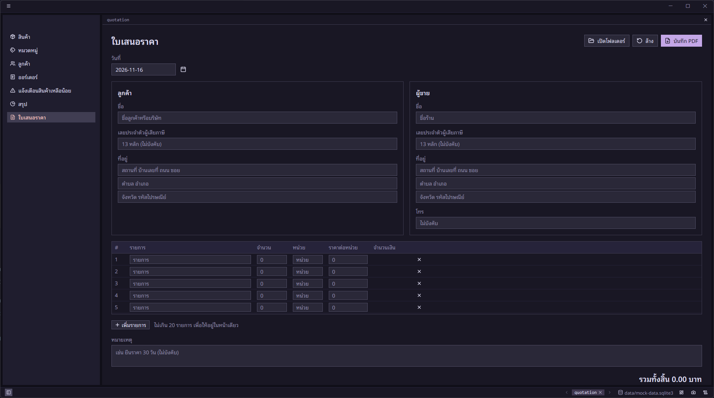
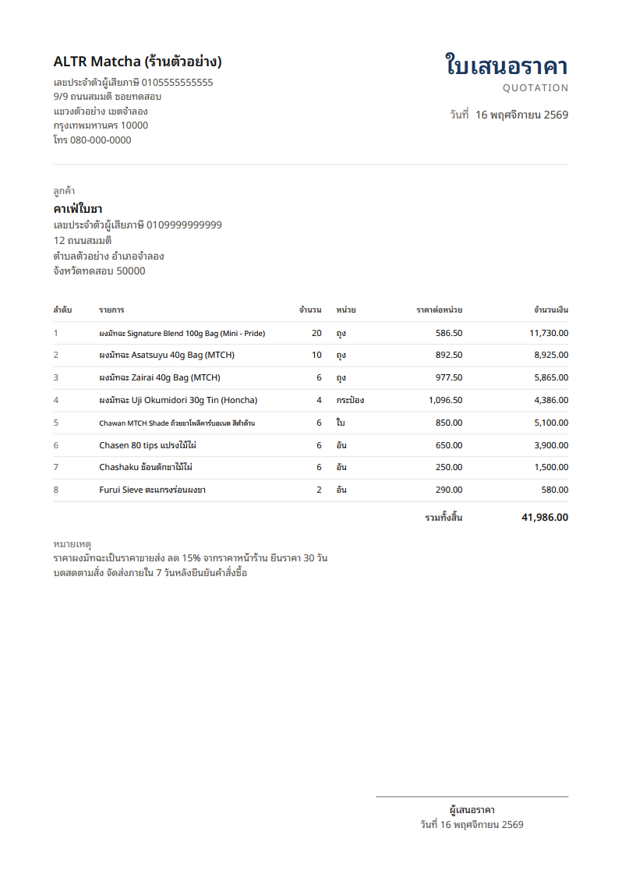
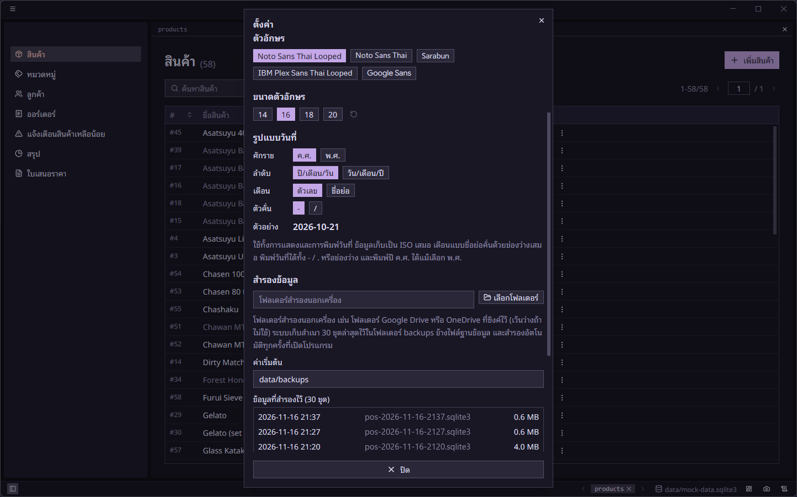

## What it is

My family business runs on a POS that used to be a Rails app. This rewrite is a
Windows desktop app in Rust with [gpui-kit](https://gpui-kit.com), the
components built on Zed's UI framework. It keeps products, stock, customers and
orders in a local SQLite database, and the interface is in Thai.

_Screenshots use a made-up database._

## The old app

A Rails app (Ruby 2.7, Rails 6.0) built in 2019. It ran the shop for seven
years, but got no new features after January 2021; since then its git history
is almost all automatic backups.

| Part     | Old (Rails, 2019)                                 | New (Rust, 2026)                         |
| -------- | ------------------------------------------------- | ---------------------------------------- |
| Language | Ruby 2.7.8 (end of life 2023)                     | Rust, edition 2024                       |
| App      | Rails 6.0.4 (end of life 2023) on Puma, in Docker | A native Windows app                     |
| UI       | HAML views, jQuery, Semantic UI, Chartkick charts | gpui-kit, its own charts and tables      |
| Data     | SQLite through ActiveRecord, prices as floats     | SQLite through rusqlite, with migrations |

## What improved

- **Stock stays right.** Deleting an order now puts its stock back, and a
  customer or product with orders can't be deleted. The old app lost track of
  stock for most products.
- **Clean data.** The import fixes duplicates, mixed orders, mistyped dates and
  float noise in prices, and reports each fix.
- **Real backups.** Snapshots with a restore command, in place of force-pushing
  the database to git.
- **A native app** instead of a Rails server running in development mode.

## Highlights

- **Panels side by side, like Zed.** Open a product, a customer and an order
  next to each other, drag the split, or zoom one panel over the rest.
- **Stock at a glance.** Each product shows a waterfall chart of its stock by
  day, week or month, with sales and stock-ins below.

- **Quotations as PDF.** Type a buyer and up to 20 lines, and the app saves a
  one-page ใบเสนอราคา (quotation) PDF.

- **Made for Thai.** Thai fonts, Thai dates (Buddhist or Western year, Thai
  month names) and a date field with a Thai calendar.

