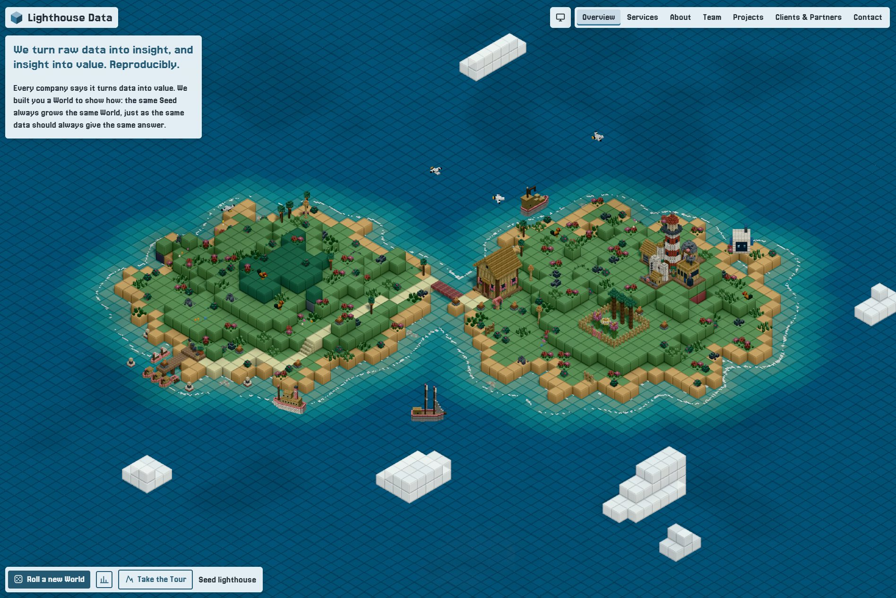
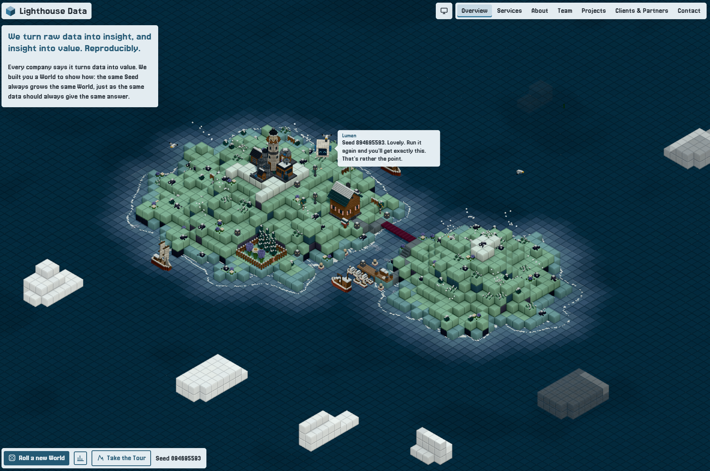
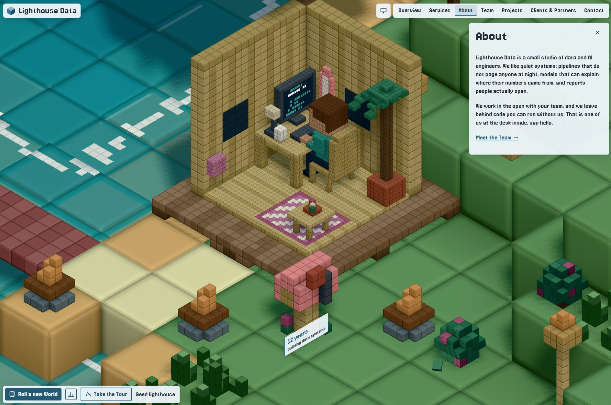

## What it is

A corporate landing page that is also a small isometric world. A seed generates
one to four islands joined by bridges, picks a biome (tropical, northern, autumn
or volcanic) and places a landmark for every section of the site: a station for
Services, a house for About, a garden for the portfolio, a dock for Clients and
a mailbox for Contact.

> **All content on the site is mock data.** The company, Lighthouse Data, is
> fictional, and so are its services, team, projects, clients, partners and
> figures. The site is a showcase of the world, not of a real business.

You can drag, pinch or scroll around the world freely, or take the Tour: a
floating voxel cube with a screen for a face leads you through the landmarks in
story order. Roll a new seed and the whole world, its buildings and its creatures
change, while the story stays the same.

## A world that feels alive

- **Ambient life per biome:** animals walk, birds circle, fish swim, leaves
  fall, clouds drift and cast shadows, and waves break on the shore. It all runs
  on one shared clock and one wind, and slows down in three tiers on weaker
  devices.
- **Day and night:** at night, torches, lamps, the lighthouse and the house's
  windows light up and throw warm light on the voxels around them.
- **The garden is the portfolio:** each project grows as a tree, and pinned
  projects bloom as large flowers at the front.
- **Look inside the house:** opening About lifts the house's roof to show one
  furnished room per biome, drawn at a finer voxel size, with a member of the
  team at the desk.

## How it is built

- **Astro + three.js**, rendering with WebGPU and falling back to WebGL 2.
- **Every landmark is a real page.** Clicking one opens a static HTML route
  (`/about`, `/garden/<slug>`, …) over the world canvas, so each section can be
  indexed, shared and read without JavaScript. Without WebGL or JS, a still of
  the world, captured at build time, and a plain menu take its place.
- **Models drawn as text.** Every building, plant, boat and decoration is an
  ASCII file, one block of characters per voxel layer, parsed into voxel arrays
  at build time. Agents can write, test and review these models, and a dev-only
  gallery shows them all for review.
- **Phones get a Story Scroll:** every section on one page, with the camera
  gliding from landmark to landmark as you scroll.
