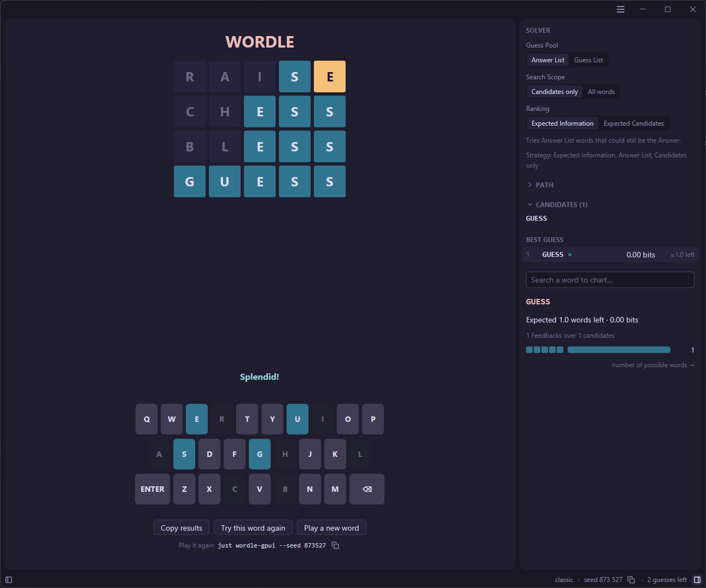
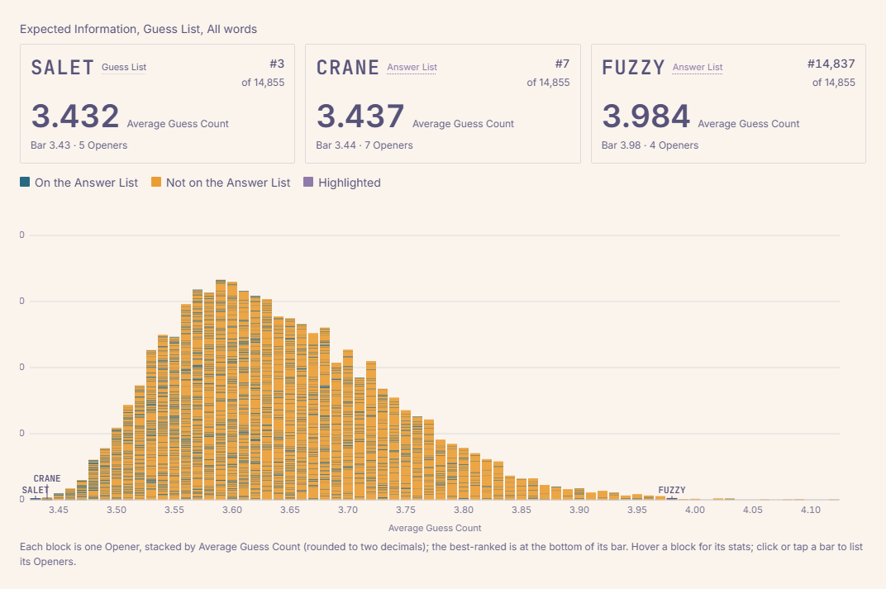
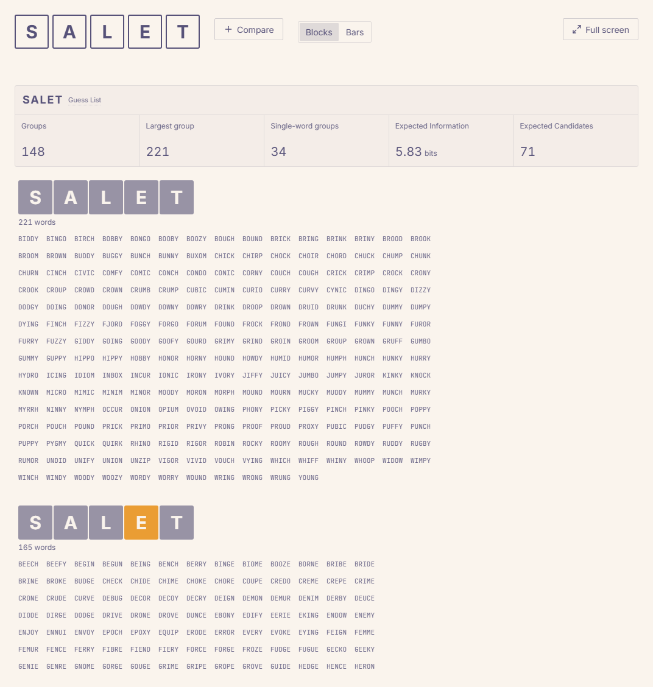
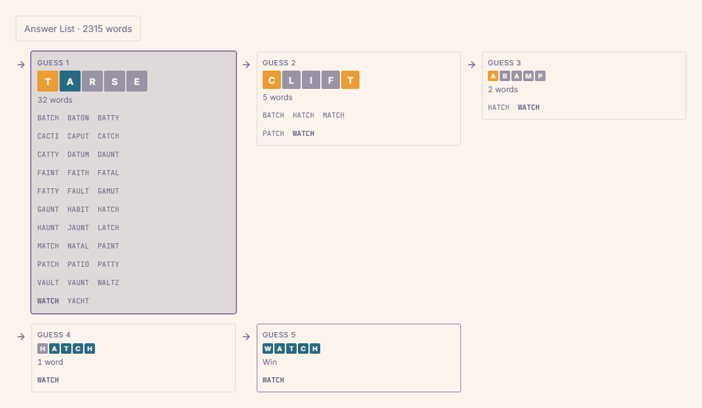

## What it is

A Wordle you can play, a solver that tells you the best next guess and why,
and the tools to turn both into articles and videos. It is the newer version of
[wordle-but-statistics](https://github.com/chuan-khuna/wordle-but-statistics),
my old project on letter statistics and guessing strategies, rebuilt with LLM
coding agents.

Every game can be replayed: a random game shows its seed, and ends with the
command to play it again, so a take can be recorded twice the same way.

## The desktop app

The main way to play is a native window written in Rust with
[gpui](https://gpui.rs), the UI framework behind the Zed editor. The board and
keyboard sit on the left, and the Solver panel on the right.

- **The Solver panel** ranks guesses by _Expected Information_ (bits, as in
  3Blue1Brown's video) or by _Expected Candidates_ (how many words are likely
  left). You choose which words it may guess and whether it only tries words
  that could still be the answer: eight strategies in all.
- **The Path** lists every guess of the game; click one to see the panel as it
  was at that step.
- **Solver mode** helps with a Wordle played somewhere else: type your guesses
  and click in their colours.
- **Precompute** plays every strategy, from every opener, against all 2,315
  answers, and saves how many guesses each one needs. The Rust build writes the
  same files, byte for byte, as the slower Python version.

## What the solver found

Played over all 2,315 answers, the best openers need about 3.43–3.47 guesses on
average. When the solver may guess any word, every strategy wins every game;
when it only guesses words that could still be the answer, a handful of games
take more than six tries.

| Strategy                                       | Best opener | Average guesses | Losses |
| ---------------------------------------------- | ----------- | --------------- | ------ |
| Expected Information, any word in the Guess List | tarse       | 3.429           | 0      |
| Expected Information, any Answer List word       | slate       | 3.454           | 0      |
| Expected Information, candidates only            | slate       | 3.529           | 7      |

## The website

A Next.js and FastAPI site with a series of eleven articles, in English and
Thai, that explain the solver step by step with interactive widgets: a feedback
scorer, a step-through game, opener rankings and a zoomable Answer × Answer
feedback matrix. Its Explore pages let you poke at the data directly.

**Opener Split** shows how one opener splits the 2,315 answers into groups by
the colours they would get back:

**Follow an Answer** plays the solver's game for one answer and shows the
words still possible after each guess:

## More ways in

- **Terminal game:** the first version, in Python with Rich, with menus, a
  coloured board and keyboard, and a 🟩🟨⬛ share grid.
- **Video:** a Slidev deck and ManimGX animations for a Thai YouTube video of
  the series.

_Wordle was created by Josh Wardle and is now owned by The New York Times.
This project isn't affiliated with either._
